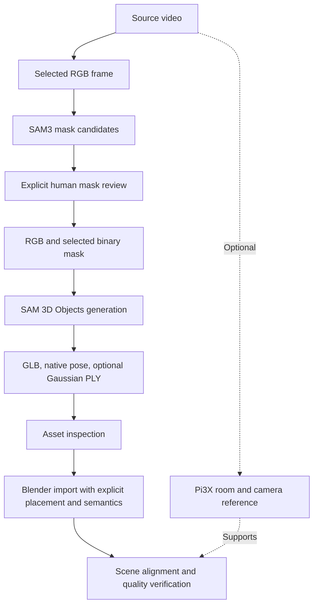

# SAM 3D Objects: Integration Progress and Performance Evaluation

Updated: November 22, 2026. Dates in the narrative use America/New_York;
raw reports retain their original timestamps. This is a report and presentation
source document, based on repository code, commit history, local artifacts and
the supplied Great Lakes failure logs. It is not a claim of final scene acceptance.

## 1. Executive summary

We added an operational SAM 3D Objects reconstruction route around the pinned
AHa-3D baseline: source frame and reviewed object mask, GPU generation, native
GLB export, and explicit import into an existing editable Blender scene. The work
includes environment compatibility handling, staged orchestration, provenance,
artifact preservation, performance instrumentation and an experimental reusable
model session.

The initial performance question was whether single-object generation was slow
because of inference or startup. Repeated fresh-process measurements showed
that runtime import and model initialization dominated, accounting for roughly
87–92% of wrapper time in the five-trial cabinet experiment. We then compared
three independent processes with one process retaining its model for three
serial requests.

The latest AB and BA experiments measured **2.58x and 2.60x speedups**, respectively,
for completing the same three cabinet requests. Total process time decreased by
approximately **61%**. Later requests in the resident process spent approximately
**12.5 seconds in inference**. Post-cleanup PyTorch allocated memory remained
stable over three requests. These observations support serial model reuse;
they do not establish long-term memory stability, visual equivalence, or a
universal speedup across objects and machines.

| Question | Current answer | Evidence boundary |
| --- | --- | --- |
| Can SAM 3D Objects run in the project environment? | Yes, official-input and cabinet outputs were generated on A40 | Specific recorded environment and upstream revision |
| Can its GLB enter an AHa-3D-compatible Blender scene? | Yes, imports, semantics and reopen checks completed | Supplied placement; no automatic alignment or visual acceptance |
| Is fresh-process startup significant? | Yes, startup dominated repeated cabinet runs | Fresh process is not a cold filesystem/cache |
| Does model reuse help? | Yes, approximately 2.6x in the latest three-request AB/BA comparisons | Fixed cabinet, seed 42, serial execution, two allocations |
| Does retained memory grow after every request? | No growth in allocated memory was observed over these three-request runs | Longer and mixed-input sequences remain untested |
| Are outputs identical? | Pose files match; GLB and splat bytes differ | Geometric and visual equivalence remain unmeasured |

## 2. Starting point and contribution relative to AHa-3D

The project pinned AHa-3D at
`82f4b1110cfe4b55fff19df3b3790852ce07b171` in the initial baseline setup.
Its released room-authoring route uses source-video reference geometry and
cameras, registered assets and Blender authoring/review. Pi3X reference geometry
is supporting evidence, not an automatically accepted editable room.

An attribution detail matters: the pinned upstream
[object-generation guide](../third_party/aha-3d/docs/OBJECT_GENERATION.md)
documents an earlier SAM 3D Objects/TRELLIS.2 pilot that was deferred, with its
generation adapters omitted from that release. Therefore the precise contribution
is **a new runnable SAM 3D Objects route for this pinned project baseline**, not
the first historical exploration of SAM 3D Objects by AHa-3D's authors. The
baseline version can be inspected independently of a dirty live checkout with:

```bash
git -C third_party/aha-3d show \
  82f4b1110cfe4b55fff19df3b3790852ce07b171:docs/OBJECT_GENERATION.md
```

Keep these components distinct:

| Component | Role in this project |
| --- | --- |
| SAM3 | Text/box-prompted 2D object segmentation |
| SAM 3D Objects | Single-image/mask-conditioned 3D object generation |
| SAM 3D Body | Separate human/body functionality; not this contribution |
| Pi3X | Optional room geometry/camera reference |
| Blender/AHa-3D | Editable scene, object semantics, placement, inspection and verification |

The SAM 3D additions live primarily in the parent project's `scripts/` and
`experiments/` directories. This work does not demonstrate an automatically
selected procedural-versus-generative agent policy, a trained model, or a
completed geometric feedback/repair loop.

## 3. Development milestones

These are code milestones; commit dates alone do not prove runtime validation.

| Date | Commit | Milestone |
| --- | --- | --- |
| Initial setup | `25380c7` | Initialize project and pin the AHa-3D baseline |
| Nov 9 | `8458f35` | Add single-request SAM 3D Objects wrapper and Slurm launcher |
| Nov 9 | `6c2c538` | Correct inference handling and strengthen input/output checks |
| Nov 9 | `1b3f568` | Add environment restoration script |
| Nov 9 | `264aa98` | Add staged workflow, runtime path setup, GPU helpers and tests |
| Nov 10 | `fd9ef54` | Integrate generated-asset Blender import into the workflow |
| Nov 10 | `65e0908` | Add fresh-process profiling experiment and stage events |
| Nov 21 | `43765b1` | Add three-request independent-process versus resident-model experiment |
| Nov 21 | `13a62b4` | Allow disabling internal timeout after incomplete startup trials |
| Nov 21–22 | Run evidence below | Complete AB, BA and repeated AB GPU comparisons; add BA validation and guidance |

The initial scope and related team research directions are documented in the
[exploration plan](../Agentic_Real2Sim_Initial_Exploration_Plan.md).

## 4. Implemented workflow and interfaces

### 4.1 Data flow



The adapters and review interfaces are implemented. The final verification box
represents required downstream evaluation, not an already validated automatic
acceptance system. A complete real video-to-reviewed-room run through every new
staged entry point has not been established by the evidence summarized here.

### 4.2 Single-request inference wrapper

[infer.py](../scripts/sam3d_objects/infer.py) accepts an image, same-size mask,
upstream source directory, checkpoint configuration, seed and a new output path.
Its main responsibilities are:

- Preserve original input bytes and produce RGB, binary-mask and overlay views.
- Reject empty, dimension-mismatched or ambiguous colored masks; support explicit
  alpha or last-channel selection when requested.
- Record source/configuration hashes, code identities, package information and
  Slurm metadata. Checkpoint contents are inventoried by size/mtime rather than
  fully hashed on every request.
- Import the adapted upstream entry point, construct the model with
  `compile=False`, run generation and export required outputs.
- Retain failures and refuse to overwrite previous output directories.
- Measure preparation, runtime import, model initialization, inference, export
  and wrapper end-to-end time; optionally emit stage-boundary events.

| Output | Meaning |
| --- | --- |
| `object.glb` | Native exported mesh asset |
| `pose.json` | Native model rotation/translation/scale, not a calibrated Blender placement |
| `splat.ply` | Optional Gaussian representation, not a triangle mesh |
| `report.json`, `events.jsonl` | Status, timing, memory and optional stage events |
| `inputs/`, `inputs.json` | Original/normalized inputs, overlay and identity records |
| `request.json`, `checkpoint.json`, `provenance.json` | Resolved configuration and provenance |
| `wrapper_snapshot.py`, `upstream_code/`, `runtime/` | Code evidence and actual adapted entry point |
| `artifacts.json` | Exported artifact sizes and SHA256 |

### 4.3 Staged video/object orchestration

[workflow.py](../scripts/sam3d_objects/workflow.py), exposed through `run.sh`, adds
`prepare`, `segment`, `review-mask`, `generate`, `review-result`, `import-scene`,
`status`, `bundle`, and optional `reference` stages. Each stage retains its own
directory, commands and logs. Case locks prevent concurrent writers. Mask
selection is explicit and hash-bound; regeneration invalidates the current
scene-import pointer instead of silently treating an old import as current.

Pi3X, SAM3 and SAM 3D Objects use separate existing environments. Frame extraction
does not itself load the Pi3X model. A new furniture request can reuse an existing
room reference rather than recomputing it. Review and result bundles support
remote/local inspection; neither successful execution nor bundling proves quality.

Operational details: [workflow guide](../scripts/sam3d_objects/WORKFLOW.md).

### 4.4 Blender and AHa-3D scene integration

[import_blender.py](../scripts/sam3d_objects/import_blender.py) imports an existing
static GLB into a saved scene, uses AHa-3D semantic grouping helpers, and saves a
new `.blend` plus semantics and an import report. It preserves the source scene
and reopens the new scene to verify transforms, hierarchy and materials.

The placement contract acts on coordinates **after Blender's glTF import**:

```text
p_world = T @ R_XYZ @ S @ p_imported
```

Translation uses metres, Euler rotation uses degrees and scale uses positive
axis factors. Native `pose.json` is not blindly reapplied. The importer supports
explicit static-object replacement and rejects duplicate IDs without `--replace`;
it does not estimate metric scale, snap to supports, solve collisions, or handle
articulated replacement automatically.

Retained evidence includes:

| Evidence | Observed outcome | Limit |
| --- | --- | --- |
| [Cabinet import](../outputs/sam3d-objects/office48-cabinet-blender-test/run-001/import_report.json) | Completed, reopened; importer total 1.45 s | Identity placement; visual review not performed |
| [Workflow import-only case](../outputs/sam3d-cases/workflow-import-smoke-001/case.json) | Completed staged import; stage wall 2.49 s | Import-only case, not full staged GPU workflow validation |
| [Synthetic added object](../outputs/sam3d-import-functional-001/added/import_report.json) | Completed with nonidentity placement and reopen check | Synthetic geometry |
| [Synthetic replacement](../outputs/sam3d-import-functional-001/replaced/import_report.json) | Explicit replacement completed and reopened | Functional behavior, not furniture fidelity |
| [Duplicate-ID rejection](../outputs/sam3d-import-functional-001/duplicate/import_report.json) | Failed as intended without replacement flag | Expected rejection, not a successful generation |

Do not use the small import times as full scene reconstruction or visual-review
costs. The supplied placement notes in some synthetic records contain historical
placeholder text; actual numeric transforms and recorded scope are authoritative.

## 5. Great Lakes runtime and storage

### 5.1 Validated runtime route

The recorded route uses Python 3.11, Torch 2.5.1+cu121, one NVIDIA A40, cluster
CUDA 12.1.1 and locally built Kaolin 0.17.0. The wrapper's validated upstream
commit is `f91db411c50efee93d8db7aeb323885650f6f722`.

The upstream notebook entry point overwrites `CUDA_HOME` with `CONDA_PREFIX`.
Our wrapper replaces exactly that assignment in a run-local copy, records the
original/patched hashes and uses the cluster toolkit. It does not edit the
external source checkout. Unknown entry-point layouts fail explicitly.
The installation history recorded a failure with the Conda CUDA toolkit and a
passing minimal compilation check with the cluster toolkit. This is environment
compatibility work, not evidence of a universally required CUDA workaround.

The official-input smoke report records model initialization of **190.35 s**,
inference of **73.22 s**, and successful mesh export. Its timing scope differs
from later wrapper reports. See the
[official smoke report](../outputs/sam3d-official-smoke/official-smoke-0RCFvu/report.json)
and [runtime guide](../scripts/sam3d_objects/README.md).

### 5.2 Filesystem layout and runtime data movement

```text
Shared storage / real2sim/
  agentic-real2sim/                 Project Git checkout
    scripts/, configs/, experiments/
    data/local/                    Inputs, normally ignored by Git
    outputs/                       Artifacts and measurements, ignored by Git
  sam3d-objects/                    Separate runtime storage
    envs/sam3d-objects/             Python and installed dependencies
    src/sam-3d-objects/             Separate upstream source checkout
    checkpoints/                   Pipeline configuration and model weights
    cache/                         HF, Torch extension and Warp caches
```

Recorded `~/eecs442_scratch/...` paths resolve to GPFS locations; the word
`scratch` does not establish node-local disk. GitHub distributes tracked code,
not installed environments, downloaded weights, caches or ignored results.

One request performs the following storage operations:

1. Python reads its executable/libraries and wrapper code.
2. Preparation scans code/package metadata, hashes source code, inventories
   checkpoint files, copies notebook evidence and inputs, and writes overlays.
   These operations touch files before the measured model load.
3. Runtime import reads the run-local adapted entry point, original upstream
   modules and installed packages/dynamic libraries. `upstream_code/` is evidence;
   it is not a complete relocated execution environment.
4. Initialization reads configurations and weights, constructs/deserializes the
   model and transfers parameters to GPU memory. The retained checkpoint directory
   inventory is approximately 12.2 GiB; this is not a measurement of bytes read
   per initialization, because not every inventoried file must be loaded and
   some checkpoints are loaded more than once.
5. Inference mainly uses in-memory inputs and the loaded model, while first-use
   dependency or kernel activity may still access caches.
6. Export writes assets; artifact hashing rereads the exported files. Process
   exit releases the model and GPU context, while filesystem/JIT caches may survive.

Moving checkpoints alone tests weight-storage placement. It does not relocate
the Python environment, upstream modules, output directory or all auxiliary
model caches. A fresh process still rebuilds the model even when file reads hit
cache; a resident process retains the actual model instance.

### 5.3 Cluster execution and preservation

The project provides interactive allocation and `sbatch` entry points. Batch
execution survives SSH disconnection; `Broken pipe` is not itself a job failure.
`squeue` shows current jobs, while `sacct` and retained reports/logs establish
historical status. New shells require path variables to be restored. Logs are
written relative to the submission/output paths, not necessarily the home directory.
`tail -f` waits for new content until interrupted; interrupting it does not stop
the Slurm job.

Completed results were copied back into ignored local `outputs/` directories.
Artifact receipt checks verified 18 exported files per completed model-reuse run,
54 across the three successful runs. These checks cover GLB/pose/splat files;
they are not an independently generated checksum of every telemetry/log file.

## 6. Performance investigation before model reuse

### 6.1 Timing and memory definitions

| Metric | Boundary and interpretation |
| --- | --- |
| Preparation | Input handling and provenance; includes many filesystem operations |
| Runtime import | Adapted entry point/dependencies plus CUDA availability/synchronization |
| Model initialization | Model construction/load, including synchronization |
| Inference | Complete model call, including preprocessing, conditioning, sampling, decoding and internal asset preparation |
| Export | Save GLB, native pose and optional splat; mesh generation is not confined to this stage |
| Wrapper end-to-end | `run()` entry through artifact completion; excludes interpreter startup and final report serialization |
| External process wall | Includes worker/interpreter startup and shutdown; excludes queue time |
| Post-cleanup memory | Allocator state after the request returns, garbage collection and CUDA synchronization |

PyTorch peaks include resident weights/caches and exclude external CUDA allocators.
Reserved memory is not equivalent to live tensors, and phase peaks must not be
added. GPU telemetry is sampled device state, not an exact trace of every kernel.

### 6.2 Initial cabinet measurement

The first retained wrapper cabinet request completed in **324.37 s**:

| Phase | Seconds |
| --- | ---: |
| Preparation | 10.79 |
| Runtime import | 139.45 |
| Model initialization | 129.77 |
| Inference | 43.14 |
| Export | 1.01 |

This established feasibility but was only one observation, not a stable latency
baseline. It reported `quality_acceptance: not_assessed`.
Source: [initial cabinet report](../outputs/sam3d-objects/office48-cabinet-20261109-215313/report.json).

### 6.3 Five fresh-process cabinet trials

The [startup experiment](../experiments/sam3d-startup-profile/README.md) fixed
inputs, seed, checkpoint/source and export setting, and ran five serial Python
processes in one A40 allocation. It used approximately 1 s telemetry, a baseline
period and 10 s gaps, without clearing caches. Run 001 was retained separately;
runs 002–005 supplied the subsequent-run statistics.

| Trial | Import (s) | Init (s) | Inference (s) | Wrapper total (s) |
| --- | ---: | ---: | ---: | ---: |
| 001 | 350.59 | 680.22 | 89.99 | 1139.80 |
| 002 | 292.17 | 301.79 | 66.70 | 683.11 |
| 003 | 316.35 | 861.95 | 109.80 | 1304.94 |
| 004 | 315.98 | 707.94 | 65.47 | 1115.32 |
| 005 | 253.13 | 692.69 | 75.04 | 1039.05 |

For runs 002–005, median import was **304.08 s**, initialization **700.31 s**,
inference **70.87 s**, export **1.30 s**, and wrapper total **1077.18 s**.
The startup fraction ranged from **86.95% to 91.81%**. Independently computed
phase medians do not necessarily sum to the median total. Peak Torch allocated
and reserved memory were approximately **17.58 GiB** and **22.29 GiB**.

The repeated runs did not monotonically become faster. Startup was dominant
and variable; the initial 324 s result was not representative of all later runs.
Source: [five-trial summary](../outputs/sam3d-startup-profile/cabinet-001/SUMMARY.md).

### 6.4 CPU/GPU evidence and interpretation

For the five-trial experiment, arithmetic sample means by phase were roughly:

| Phase | CPU utilization, one core = 100% | Device GPU utilization |
| --- | ---: | ---: |
| Runtime import | 5–7% | Approximately 0% |
| Initialization | 4–13% | 0.4–0.9% |
| Inference | 24–40% | 21–38% |

This suggests substantial waiting rather than continuous CPU/GPU saturation.
Candidates include shared-filesystem metadata/read latency, dependency/cache
behavior, scheduling, locks or initialization waits. These samples do not identify
a root cause. `rchar` is not physical disk throughput, and Linux `read_bytes`
does not comprehensively account for remote-filesystem traffic. Missing metrics
are not zero usage. Source: [raw telemetry](../outputs/sam3d-startup-profile/cabinet-001/resources.jsonl).

### 6.5 Other object inputs

Additional two-view requests completed for the TUM
`freiburg3_long_office_household` scene. These are distinct from the Office48
cabinet performance input. Their metadata describes manually traced/GrabCut-
refined masks, not a completed SAM3 review stage for every sample.

| Object | Source RGB indices | Import (s) | Init (s) | Inference (s) | Wrapper total (min) |
| --- | --- | ---: | ---: | ---: | ---: |
| Rear wooden chair | 1350, 1530 | 422–453 | 760–796 | 76–110 | 21.4–23.1 |
| Far black monitor | 1410, 1440 | 231–232 | 212–287 | 47–54 | 8.4–9.8 |
| Central divider/bin-end region | 1470, 1590 | 221–284 | 234–255 | 45–59 | 8.6–10.3 |

The chair ran on gl1504; monitor/divider requests ran on gl1528. These results
support startup dominance across more requests, but do not isolate object
complexity, frame-selection policy quality, mask quality or scene-level fidelity.
Sources: [chair](../rear_chair_inputs/results/),
[monitor](../monitor_2_inputs/results/), [divider](../divider_inputs/results/).
These input/result directories may be present locally without being tracked by Git.

## 7. Model reuse experiment

### 7.1 Hypothesis and implementation

Hypothesis: for multiple serial object requests, retaining the model avoids
repeated import and initialization and improves total completion time without
unbounded retained request memory.

The original pair-running scripts start a fresh Python process per input.
We added an opt-in `InferenceSession` to the wrapper, used by the
[reuse experiment runner](../experiments/sam3d-model-reuse/run.py). The ordinary
single-request CLI remains fresh-process execution. This is a controlled serial
experiment, not a production server, concurrent batching system or result cache.

| Setting | A: fresh | B: reuse |
| --- | --- | --- |
| Requests | 3 identical cabinet requests | Same 3 requests |
| Python processes | 3 serial workers | 1 worker |
| Runtime imports / model constructions | 3 / 3 | 1 / 1 |
| Seed | 42 per request | 42 per request |
| Export | GLB, pose and splat | Identical setting |
| Storage layout | Existing shared paths | Same paths |
| Between-request result cleanup | Return from wrapper, GC, CUDA sync | Same; model/runtime retained |

The session rejects a changed source/checkpoint/configuration/toolkit identity
key. The controller checks fixed input/code hashes and checkpoint inventories
before/after workers. It does not fully hash all weight bytes or prove absence
of every external environment change.

The main comparison is:

```text
speedup = sum(A worker lifetimes) / B worker lifetime
```

Both sides complete three saved outputs. Interpreter startup/shutdown counts;
controller identity checks, baseline sampling, inter-group gap and queue time do
not. Later-request latency is reported separately and is not substituted for B's
full cost. Reuse-path import/init timings are not new load measurements.

### 7.2 Incomplete pilots and timeout correction

Two early attempts ended before the first independent worker finished:

| Run | Job | Recorded outcome |
| --- | --- | --- |
| `cabinet-3req-ab-001` | 66557956, gl1518 | `TimeoutExpired` after 1800 s; last supplied logs were in checkpoint loading |
| `cabinet-3req-ab-002` | 66562003, gl1506 | `TimeoutExpired` after 3600 s; weights-completed message appeared, but no completed request was established |

These are failures of the configured worker time budget, not proof of model
incompatibility. A weights-completed log is not request completion. Neither
attempt supplied a completed A/B comparison. Failure details here are supported
by the supplied terminal transcripts; their complete directories are not part
of the currently downloaded successful-run evidence set.

The runner now defaults to no internal deadline (`--timeout 0`) and records the
policy. Slurm still imposes a seven-hour default allocation limit. Positive
timeouts remain supported. Failed output directories are preserved; a new
process cannot resume an already loaded model after the old one was terminated.

### 7.3 Completed experiment ledger

| Run directory | Order | Date | Job | Node | A total (min) | B total (min) | Speedup | Time reduction |
| --- | --- | --- | --- | --- | ---: | ---: | ---: | ---: |
| `cabinet-3req-ab-003` | AB | Nov 21 | 66564531 | gl1516 | 96.43 | 12.92 | 7.47x | 86.61% |
| `cabinet-3req-ba-001` | BA | Nov 22 | 66624171 | gl1506 | 24.18 | 9.30 | 2.60x | 61.54% |
| `cabinet-3req-ab-004` | AB | Nov 22 | 66626318 | gl1508 | 22.04 | 8.53 | 2.58x | 61.29% |

Each run completed all six requests; all four worker processes per run exited 0.
The latest AB/BA pair has identical resolved requests and recorded identities.
Recorded environment fields differ only in job ID; actual node and GPU differ.
This does not prove all unrecorded system conditions were identical.

Primary evidence:
[first AB](../outputs/sam3d-model-reuse/cabinet-3req-ab-003/summary.json),
[BA](../outputs/sam3d-model-reuse/cabinet-3req-ba-001/summary.json),
[repeated AB](../outputs/sam3d-model-reuse/cabinet-3req-ab-004/summary.json).
Their adjacent `experiment.json`, per-request reports, worker records, snapshots
and `resources.jsonl` retain identities and measurement details. The local
Slurm logs for jobs 66564531 and 66624171 are also present; the job 66626318
Slurm stdout file was not found locally when compiling this document.

### 7.4 Latest AB versus BA: the main repeatability result

| Metric | Repeated AB (`ab-004`) | BA (`ba-001`) |
| --- | ---: | ---: |
| A mean process seconds per output | 440.90 | 483.56 |
| B amortized process seconds per output | 170.66 | 185.99 |
| B first request, worker-internal wall including cleanup (s) | 438.04 | 471.80 |
| B second request, same boundary (s) | 23.15 | 26.37 |
| B third request, same boundary (s) | 16.29 | 19.28 |
| B second inference only (s) | 12.47 | 12.53 |
| B third inference only (s) | 12.55 | 12.55 |
| Total minutes saved | 13.51 | 14.88 |

The first-request rows exclude interpreter startup/shutdown and therefore do
not sum directly to B's external process time. Complete later-request latency
still varies because preparation, provenance and filesystem work remain.

The latest AB/BA speedups are close despite reversed order. This supports a
repeatable benefit in this workload. It is not a confidence interval: each
order has one latest run, and allocations differ in node and time. Do not
average the first 7.47x result into a universal speedup claim.

### 7.5 Why the first AB was much slower

Independent-worker CPU time stayed similar while wall time changed greatly:

| Independent worker | External wall (min) | User + system CPU time (s) |
| --- | ---: | ---: |
| First AB A1 | 37.54 | 84.97 |
| First AB A2 | 40.36 | 82.32 |
| First AB A3 | 18.53 | 86.55 |
| BA A1 | 7.87 | 87.16 |
| BA A2 | 7.72 | 90.15 |
| BA A3 | 8.59 | 91.97 |

This supports reduced waiting as an explanation, rather than a large reduction
in CPU work. CPU time alone cannot separate GPU execution, filesystem waits,
synchronization, scheduling and other blocking. The first AB's independent-worker
import times were 444–723 s and initialization times 463–1331 s; BA's were
184–189 s and 177–217 s. AB also became faster within its own allocation.

Node conditions, shared-filesystem load, file/metadata/JIT caches, and resource
contention are hypotheses. No completed controlled storage experiment or
system-level trace identifies the root cause. The early 7.47x result combines
reuse with unusually variable startup conditions; it remains real recorded
evidence but is less suitable as the representative speedup.

### 7.6 Memory and output consistency

Across all three successful resident-model runs, each run's post-cleanup Torch
allocated memory was constant across its three requests at approximately
**12.822 GiB**. Reserved memory changed from **22.293 to 22.295 GiB** after the
second request and then remained stable. The latest runs' sampled device-memory
peak was approximately **22.663 GiB**. This is consistent with bounded short-run
retention and allocator reuse, not proof of no long-term leak.

All 18 pose files across the three successful runs have the same SHA256.
GLB and splat files differ within both fresh and resident groups. Basic GLB
inspection found vertex counts of 211352–211372 in `ab-004` and 211344–211370 in
`ba-001`, with closely matching bounding boxes. Differences therefore are not
only filename metadata. Counts/bounds are coarse checks, not geometric or visual
equivalence metrics. Fresh-process variation means hash differences alone cannot
diagnose state pollution in the resident session.

## 8. Completed work, open work and claim boundaries

| Area | Current status | Appropriate claim |
| --- | --- | --- |
| Environment compatibility | Real official-input and cabinet generation completed | Recorded A40 route is operational |
| Wrapper/provenance | Implemented and exercised by real GPU runs | Inputs and outputs can be audited from retained evidence |
| Full staged workflow | Implemented with CPU tests and import-only smoke evidence | Available orchestration; full real staged end-to-end acceptance remains open |
| Blender import | Real cabinet import and synthetic behavior checks completed | Assets can be saved/reopened with semantics and supplied transforms |
| Automatic metric alignment | Not established | Placement remains an explicit external input |
| Fresh-process profiling | Five trials plus later independent-worker measurements completed | Startup is dominant and variable |
| Three-request model reuse | AB, BA and repeat AB completed | Latest pair: approximately 2.6x total-process speedup |
| Long sequences and mixed inputs | Not completed | No claim of production robustness or absence of state contamination |
| Output quality equivalence | Hash/coarse mesh checks only | No claim of equivalent reconstruction fidelity |
| GPFS versus local checkpoint experiment | Planned, not completed | No causal claim that GPFS is the bottleneck |
| Agent tool selection and verification repair | Broader project direction | Not demonstrated by these integration/performance experiments |

CPU tests cover input rejection, provenance, session reuse, result-reference
release, subprocess counts/order, timeout behavior and summary semantics. Synthetic
Blender tests cover hierarchy/material preservation, transforms, replacement,
duplicate-ID rejection and source preservation. These checks complement real run
records; they cannot replace GPU, quality or acceptance evidence.

Validation entry points:

```bash
python3 -m unittest discover -s scripts/tests -v
python3 -m unittest discover -s experiments/sam3d-startup-profile/tests -v
python3 -m unittest discover -s experiments/sam3d-model-reuse/tests -v
bash -n experiments/sam3d-model-reuse/run.sbatch
```

## 9. Next experiments, in priority order

1. **Mixed-input resident session.** Process cabinet, chair, monitor, divider,
   then cabinet again. Compare against matching independent-process requests.
   Preserve per-request seeds, input identities and first/last cabinet outputs.
   This requires extending the current fixed-request experiment to accept a
   request list; it is not already implemented by the present CLI.
2. **Output equivalence and usefulness.** Compare fresh-repeat variation against
   fresh-versus-resident variation using geometry distances and fixed-camera
   rendered comparisons. Inspect disconnected parts, thin supports, color and
   materials. Record acceptance rate and manual repair time. Without 3D ground
   truth, do not label self-consistency as reconstruction accuracy.
3. **Longer memory stability.** Use approximately 20 serial requests, retain
   allocated/reserved and device-memory measurements after cleanup, and test
   both repeated and varying inputs. Separate a one-time plateau from continued
   growth. A three-request pilot cannot establish a leak rate.
4. **Controlled startup/storage diagnosis.** In one allocation, compare the same
   request using shared versus verified node-local checkpoint storage, alternating
   A/B order for at least three pairs. Hold code/environment/caches/output layout
   fixed, record staging cost and verify actual resolved weight paths. Split
   checkpoint reading, deserialization, construction and device transfer. Test
   code/environment relocation separately if import remains slow.
5. **Steady-state speed/quality tradeoff.** After equivalence checks, vary one
   generator's sampling steps at a time from the recorded 25-step settings.
   The current wrapper does not expose all these controls. Changing export
   `save_splat` alone is not proof of skipping Gaussian generation internally.
6. **Scene-level evaluation.** Calibrate scale/orientation/placement, render the
   asset through source cameras, evaluate silhouettes/contact/collisions, and
   compare against the procedural/asset baseline under equal review budgets.

## 10. Material for a report and presentation

### 10.1 Suggested report structure

1. **Motivation:** add image-conditioned assets for furniture whose appearance
   or shape is costly to reproduce procedurally.
2. **Baseline and contribution:** identify the pinned release and its omitted
   generation adapter; describe our operational integration and measurement work.
3. **System:** frame/mask provenance, environment separation, generation outputs,
   Blender placement contract and explicit review boundaries.
4. **Experimental method:** fixed cabinet/seed/configuration, fresh versus reused
   processes, timing boundaries, memory definitions and AB/BA ordering.
5. **Results:** five-trial startup breakdown, completed reuse ledger, latest
   2.58x/2.60x comparisons, stable later inference and short-run memory evidence.
6. **Limitations:** environmental variability, small sample, one repeated object,
   nonidentical outputs, unverified alignment/quality and missing causal diagnosis.
7. **Next steps:** mixed-input sessions, quality comparison, longer sequences and
   integration with scene verification and tool selection.

### 10.2 Suggested eight-slide narrative

| Slide | Main message | Evidence/visual |
| --- | --- | --- |
| 1 | Extend the current AHa-3D baseline with image-conditioned object assets | Baseline versus added-route diagram |
| 2 | Build an auditable frame/mask-to-GLB workflow | Source frame, reviewed mask, GLB and provenance files |
| 3 | Make generated assets usable in an editable scene | Blender import and placement contract; label identity-placement demos |
| 4 | Diagnose where time goes | Five-trial phase table/stacked timing chart |
| 5 | Test model reuse fairly | Three fresh workers versus one resident worker; AB/BA protocol |
| 6 | Obtain repeatable total-time savings | Latest AB: 22.04 to 8.53 min; BA: 24.18 to 9.30 min |
| 7 | Separate speed from correctness | Approximately 12.5 s later inference, stable cleanup memory, nonidentical outputs |
| 8 | Define remaining research | Mixed inputs, geometric equivalence, long-run memory and scene verification |

### 10.3 Report-ready results paragraph

> We integrated a SAM 3D Objects generation route with the pinned AHa-3D baseline,
> including reviewed image/mask inputs, reproducible execution records, native
> asset export and explicit Blender scene import. Fresh-process profiling showed
> that import and model initialization dominated single-request latency. In two
> latest order-reversed experiments, a resident model completed three identical
> cabinet requests 2.58x and 2.60x faster than three independent processes,
> reducing total process time by approximately 61%. Subsequent inference calls
> took approximately 12.5 seconds, and post-cleanup allocated GPU memory remained
> stable across three requests. Output geometry was not bitwise identical, and
> geometric equivalence, long-term stability and scene-level quality remain open.

### 10.4 Claims to avoid

- "We invented SAM 3D integration for AHa-3D": upstream documents a deferred pilot.
- "SAM 3D inference takes 12.5 s": qualify this as later calls on the fixed
  cabinet in a resident process; include first-request and preparation costs.
- "The system is 7.47x faster": identify that run and its variable conditions;
  use the latest AB/BA pair for the repeatability result.
- "GPFS is proven to be the bottleneck": a controlled storage test is still open.
- "Reuse preserves identical geometry" or "there is no memory leak": neither
  claim follows from the current output checks and three-request sequences.
- "The object is correctly placed/physically valid": import/reopen and an
  identity transform do not establish alignment, contact or collision validity.
- "SAM 3D improves quality over procedural AHa-3D": no controlled quality
  comparison has been established by these performance experiments.

## 11. Evidence and reproducibility index

| Topic | Canonical code/protocol | Local run evidence |
| --- | --- | --- |
| Initial project scope | [Exploration plan](../Agentic_Real2Sim_Initial_Exploration_Plan.md) | Scope definition, not result evidence |
| Inference/runtime | [Wrapper guide](../scripts/sam3d_objects/README.md), [infer.py](../scripts/sam3d_objects/infer.py), [env.sh](../scripts/sam3d_objects/env.sh) | [Official smoke](../outputs/sam3d-official-smoke/official-smoke-0RCFvu/report.json), [cabinet](../outputs/sam3d-objects/office48-cabinet-20261109-215313/report.json) |
| Staged workflow | [Workflow guide](../scripts/sam3d_objects/WORKFLOW.md), [controller](../scripts/sam3d_objects/workflow.py) | [Import-only smoke](../outputs/sam3d-cases/workflow-import-smoke-001/case.json) |
| Blender import | [Importer](../scripts/sam3d_objects/import_blender.py), [placement example](../configs/sam3d_placement.example.json) | [Cabinet import](../outputs/sam3d-objects/office48-cabinet-blender-test/run-001/import_report.json), [synthetic checks](../outputs/sam3d-import-functional-001/) |
| Startup profiling | [Protocol](../experiments/sam3d-startup-profile/README.md) | [Five-trial root](../outputs/sam3d-startup-profile/cabinet-001/) |
| Model reuse | [Protocol](../experiments/sam3d-model-reuse/README.md), [runner](../experiments/sam3d-model-reuse/run.py), [Slurm launcher](../experiments/sam3d-model-reuse/run.sbatch) | [AB-003](../outputs/sam3d-model-reuse/cabinet-3req-ab-003/), [BA-001](../outputs/sam3d-model-reuse/cabinet-3req-ba-001/), [AB-004](../outputs/sam3d-model-reuse/cabinet-3req-ab-004/) |

Raw outputs, runtime environments and weights are not distributed by this Markdown
or by an ordinary Git clone. Links into `outputs/` and the extra object-input
directories require the preserved local/downloaded evidence. Historical requests
retain absolute remote paths; use explicit path overrides or the existing
machine configuration when reproducing elsewhere. Preserve raw reports and failed
runs rather than rewriting them to match current code. This document supersedes
older broad status statements in overview guides only where the evidence above
establishes later progress; operational protocols remain in their own READMEs.
